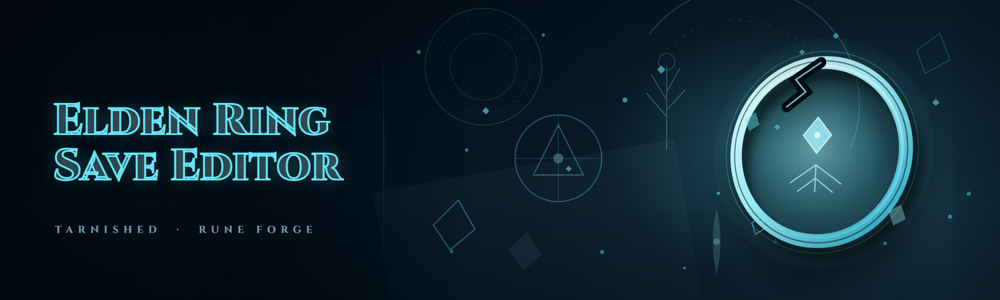

  
  
  

  

  
  

---

ELDEN RING save editor: edit stats, runes, items, weapons, armor; unlimited respecs, instant leveling, full inventory unlock.

## Overview

ELDEN RING save editor: edit stats, runes, items, weapons, armor; unlimited respecs, instant leveling, full inventory unlock.

  

## License

[MIT License](LICENSE)

  

